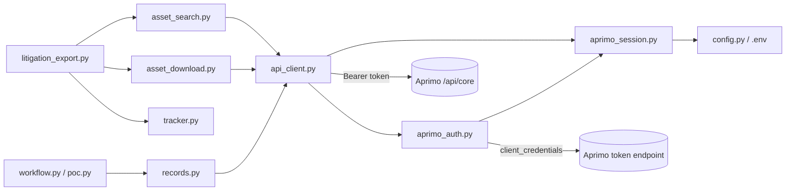
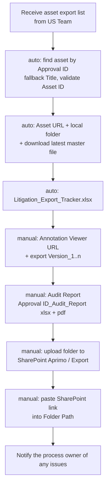

# eDAM (Aprimo DAM) Automation

Python automation for an Aprimo DAM tenant using the Aprimo REST API with OAuth2 client credentials.

---

## 1. Project structure

| File | Purpose |
|---|---|
| `config.py` | Loads settings from `.env` (URLs, client id/secret, proxy) |
| `aprimo_session.py` | Builds the HTTP session: corporate proxy + Windows CA certificate bundle |
| `aprimo_auth.py` | `TokenProvider` – gets and caches the OAuth token, renews it before expiry |
| `api_client.py` | `AprimoClient` – adds auth + API headers to every call (`get`, `post`) |
| `records.py` | Record helpers: `list_records`, `get_record`, `field_values` |
| `poc.py` | Small proof of concept: token → list records → read one record's metadata |
| `workflow.py` | Workflow: export record metadata to CSV/JSON |
| `asset_search.py` | Find assets by Approval ID (`byr_approvalId`) or Title (`byr_Title`); build Spaces asset URL |
| `asset_download.py` | Download the latest master file via a download order; list file versions |
| `tracker.py` | Read the asset export list (.xlsx/.csv) and write the tracker Excel |
| `litigation_export.py` | **US Litigation Activity workflow** (see section 3) |
| `samples/litigation_input_sample.csv` | Sample input for the litigation workflow |
| `requirements.txt` | Python dependencies |
| `.env.example` | Template for `.env` |



---

## 2. Manual – setup step by step

### Step 1: Prerequisites
- Windows with Python 3.10+
- Network access through the corporate proxy (if any)
- An Aprimo **Integration registration** (client credentials). Ask an Aprimo admin to create one under
  *Administration → Integration → Registrations* and share the **Client ID** and **Client Secret**.

### Step 2: Install dependencies
```powershell
cd "C:\Users\<you>\Documents\GIT\automation\eDAM"
python -m pip install --user -r requirements.txt
```
If pip hangs or reports a proxy parsing error, a pip config file contains a placeholder proxy.
Run `pip config debug` to find it and fix the `proxy` entry.

### Step 3: Create `.env`
Copy the template and fill in the values:
```powershell
Copy-Item .env.example .env
```

| Key | Value |
|---|---|
| `URL` | `https://<tenant>.dam.aprimo.com/dam/` (Spaces UI, used for Asset URLs) |
| `AUTH_URL` | `https://<tenant>.aprimo.com/login/connect/token` |
| `API_BASE` | `https://<tenant>.dam.aprimo.com/api/core/` (optional, derived from `URL`) |
| `INPUT_FILE` | Default input for `litigation_export.py` (optional) |
| `CLIENT_ID` | Integration client id |
| `CLIENT_SECRET` | Integration client secret |
| `PROXY` | `http://<user>:<password>@<proxy-host>:<port>` (optional) |

`.env` is git-ignored. Never commit it.

### Step 4: Verify authentication (POC)
```powershell
python poc.py
```
Expected output:
```
Step 1: token
  OK (client_credentials)
Step 2: list records
  totalCount=<n>
  - <record id>  status=Released ...
Step 3: record <record id> with fields
  18 populated fields
  byr_Title: ...
```

### Step 5: Run the workflow
```powershell
python workflow.py --max 20
```

| Option | Default | Description |
|---|---|---|
| `--max` | `20` | Maximum number of records to export |
| `--page-size` | `50` | Records per API page |
| `--out` | `output` | Output folder |

Result: `output/records_<timestamp>.csv` and `.json` with one row per record (`id`, `status`, and all populated `byr_*` fields).
Classification/option fields contain Aprimo IDs, not labels.

---

## 3. US Litigation Activity process

Based on *US Litigation Activity.pdf*. Steps marked **[auto]** are done by `litigation_export.py`; steps marked **[manual]** have no public API and are still done in the eDAM UI.



### Step 1 [manual]: Receive the asset export list
Get the list from the US Team. Save it as `.xlsx` or `.csv` with these columns (header names are matched case/space-insensitively):

| Column | Required | Notes |
|---|---|---|
| `Approval ID` | preferred | e.g. `APP-0001` |
| `Title` | fallback | Used when no Approval ID is given or nothing is found |
| `Asset ID` | optional | Record ID; used to pick the right asset when several match |

See `samples/litigation_input_sample.csv`.

### Step 2 [auto]: Find assets, fill Asset URL, download files
```powershell
python litigation_export.py "C:\path\to\asset_export_list.xlsx"
```

| Option | Default | Description |
|---|---|---|
| `--out` | `output\litigation` | Base output folder (a timestamped run folder is created) |
| `--no-download` | off | Only resolve assets and URLs, skip file download |

For each row the script:
1. Searches by `Approval ID` (`byr_approvalId`); if nothing is found, searches by `Title` (`byr_Title`).
2. If several assets match, filters by `Asset ID`. If it is still ambiguous, the row is flagged *Multiple matches – add Asset ID*.
3. Builds the **Asset URL**: `<URL>contentitems/<Record ID>`.
4. Creates folder `output\litigation\<run>\<Approval ID>\` and downloads the latest master file into it.

Output:
```
output\litigation\20261103_184313\
├── Litigation_Export_Tracker.xlsx
├── APP-0001\<master file>
└── APP-0002\<master file>
```

Tracker columns: `Approval ID, Title, Asset ID, Record ID, Match Status, Asset URL, Annotation Viewer URL, Downloaded File, Local Folder, Folder Path, Manual Steps Pending, Notes`.

Review `Match Status` first: fix rows with *Not found* or *Multiple matches* (add the `Asset ID`) and run again.

### Step 3 [manual]: Annotation Viewer URL and annotated versions
In eDAM: **Activities → open the Asset Activity → expand menu → Aprimo DAM Assets**.
1. Select the asset. If several are shown, use the `Record ID` from the tracker.
2. Open it in the Annotation Viewer, copy the URL of the latest version into the tracker column **Annotation Viewer URL**.
3. Export **all** versions with annotation comments visible:
   - New Annotation Viewer: **Export**
   - Old Annotation Viewer: **Print**
4. Save them in the asset's folder (`Local Folder` column) as `Version_1`, `Version_2`, `Version_3`, ...

### Step 4 [manual]: Audit Report
In eDAM: **Reports → Task Report LMR CH** → enter the Approval ID → **Continue**.
Export as **Excel** and **PDF**, named `<Approval ID>_Audit_Report`, into the same folder.

### Step 5 [manual]: Upload to SharePoint
Upload the complete run folder from `output\litigation\<run>\` to SharePoint **Aprimo → Export** (Litigation Teams channel → General). Request channel access if needed.

### Step 6 [manual]: Share folder link
1. Select the uploaded folder in SharePoint → **Copy Link**.
2. Paste the link into the **Folder Path** column for each row of the main export file.
3. Share the file / path with the US Legal Team (email is fine). Notify the process owner of any issues with exported files.

### Checklist per asset
- [ ] Match Status = *Matched by ...*
- [ ] Asset URL filled (auto)
- [ ] Master file downloaded (auto)
- [ ] Annotation Viewer URL filled
- [ ] Version_1..n exported with comments
- [ ] `<Approval ID>_Audit_Report.xlsx` and `.pdf`
- [ ] Uploaded to SharePoint, Folder Path filled

---

## 4. How authentication works

1. `aprimo_auth.TokenProvider` sends:
   ```
   POST https://<tenant>.aprimo.com/login/connect/token
   Authorization: Basic base64(CLIENT_ID:CLIENT_SECRET)
   Content-Type: application/x-www-form-urlencoded

   grant_type=client_credentials
   ```
2. Response contains `access_token` (valid **600 seconds**) with scopes `api filestore-access legacy-api reporting-api`.
3. The token is cached and renewed automatically 60 seconds before it expires.
4. `api_client.AprimoClient` adds these headers to every API call:
   ```
   Authorization: Bearer <access_token>
   API-VERSION: 1
   Accept: application/json
   ```

Username/password login is **not** supported for scripts (the UI client `DamUI` returns `unauthorized_client`). Always use the integration client.

---

## 5. Using the client in your own scripts

```python
from api_client import AprimoClient
from records import list_records, get_record, field_values

client = AprimoClient()
page = list_records(client, page=1, page_size=10)
record = get_record(client, page["items"][0]["id"])
print(field_values(record)["byr_Title"])

# Any other /api/core endpoint
client.get("record/<id>/files")
```

Useful API facts:
- Paging: headers `page` and `pageSize`
- Expand related data: header `select-record` (e.g. `fields`, `thumbnail`, `files`)
- API reference: https://developers.aprimo.com/

---

## 6. Troubleshooting

| Symptom | Cause | Fix |
|---|---|---|
| `CERTIFICATE_VERIFY_FAILED` | Corporate proxy re-signs HTTPS with a corporate root CA | Already handled in `aprimo_session.py` (uses Windows certificate store). Do not disable verification. |
| `407 Proxy Authentication Required` | Missing/wrong proxy credentials | Check `PROXY` in `.env` |
| `400 unauthorized_client` | Wrong client (e.g. `DamUI`) or grant type | Use the integration `CLIENT_ID`/`CLIENT_SECRET` with `client_credentials` |
| `401 Unauthorized` on API calls | Token expired or wrong scope | Token renews automatically; check the integration has the `api` scope |
| `.py` file becomes empty after saving in VS Code | Databricks extension treats `.py` as a notebook and saves only `# Databricks notebook source` | Disable the Databricks extension for this workspace, or edit with a plain text editor |
| Script prints nothing | File was emptied (see above) | Check file size: `Get-ChildItem *.py` |
| Row shows *Not found* | Approval ID/Title not in `byr_approvalId`/`byr_Title`, or typo | Check the value in Spaces; add `Title` or `Asset ID` |
| Row shows *Multiple matches* | Title is not unique | Add the `Asset ID` (Record ID) column |
| `Download failed` in Notes | File processing not finished or download not allowed | Retry later; check `preventDownload` on the file version |

---

## 7. Next steps
- Automate Annotation Viewer export and Audit Report (UI-only today; candidate for browser automation)
- SharePoint upload via Microsoft Graph (needs an Entra app registration)
- Download all file versions (`asset_download.file_versions`) instead of only the latest
